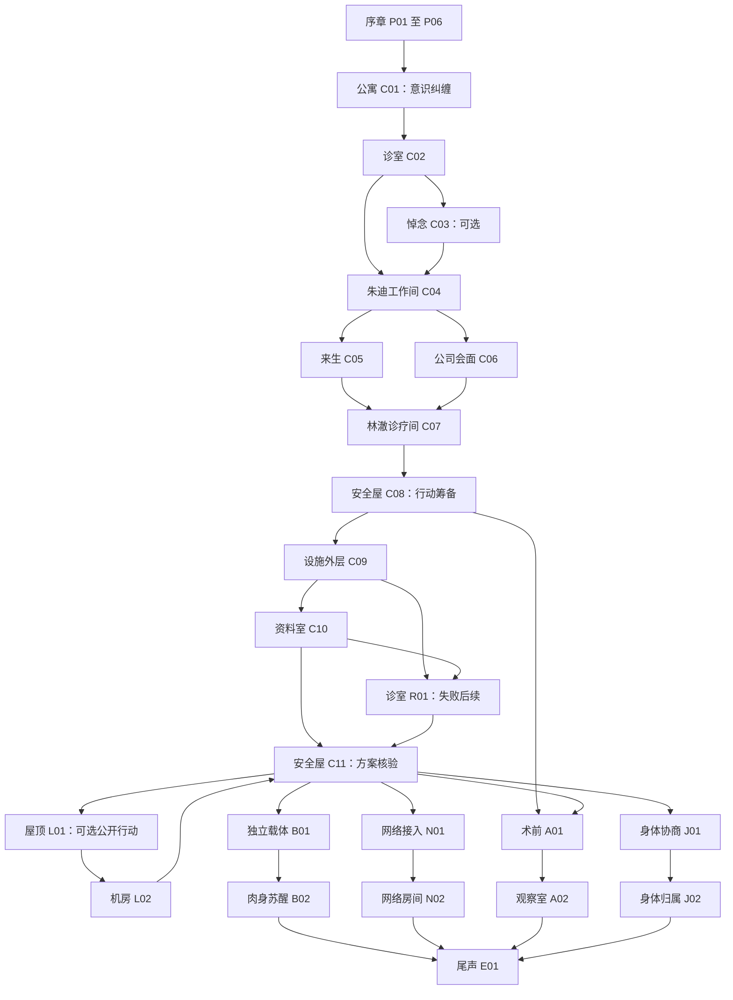

# cyberpunk 2077

本文是场景故事稿，包含作者可见的剧情与分支。每个互动场景可以容纳多轮对话、调查和 action，场内发生的事持续影响后续互动；玩家结束场景阶段后，才形成一个完成的 turn。场景编号是剧情身份，不是第几次聊天，也不是每局固定的回合序号。

通用设计依据：[回合、场景与分支流转](../turn-flow.md)、[运行机制](../runtime.md)。人物背景与原作资料见[故事概览](cyberpunk-2077-story.md)。本文维护具体场景、原创对白和故事因果，不生成最终模板、JSON、字段表或程序规则；场景式运行能力仍未开发。

## 阅读与创作约定

剧本仍有一个固定锚点：V 盗取 Relic，经历杰克之死与德克斯的背叛，最终与强尼的意识纠缠。序章以“命运已定的往事”呈现，小分支改变留下的关系、证据、遗物和承诺。锚点之后的未来开放，不要求回归原作结局。

以下场内段落是可交叉展开的戏，不要求玩家按编号逐项点击。人物会回应已经发生的事：V 把资料交出去后，不能继续假装自己拥有唯一副本；强尼听到 V 谈销毁他后，下一次交流会带着这次争执；一次承诺是否可信，要看后来有没有兑现。没有新信息的重复追问不重复奖励，也不强制推进。

普通场景在局势足以进入下一阶段时允许结束。结束之前还可以问话、检查、补救或改变尚未落实的决定；已经做出的交易、公开的信息与实际损失会保留。过渡场景只阅读正文并确认结束。只有真正发生的终局才可以直接结束故事。

本文的新对白均为原创。**“回声计划”、工程师林澈、节点维护者渡鸦、未启用的独立载体和后续设施行动均为本剧本的改编内容。** 它们借用人格印迹、神舆、网络与 Relic 的世界概念，不表示这些人物、项目或治疗方法在原作中存在。

## 故事贯穿线

夜之城的上层购买长生的承诺，下层的人被用来证明承诺是否可信。一条冷链物流记录把两种生活连接起来：序章里，它只是目标套房的一张不起眼的设备回执；后来，V 发现相同标记出现在与 Relic 有关的研究资料上。

“回声”是一座处理人格研究材料的外围设施，不是神舆的替代品。它保存测试记录、受试人格与有限的接口设备。林澈知道其中一部分；荒坂想收回失控的材料；网络维护者想救走被扣押的意识；中间人只看见一份会让公司付出大价钱的清单。

这些材料可以帮助验证分离、承载和治疗方案，却没有一份文件能够让 V 自动痊愈。V 与强尼必须决定怎样获得它、怎样使用它，以及是否把同样被困住的人也算进计划。

有三件小东西贯穿全篇：杰克留下的一枚磨损筹码，证明他曾经期待进入来生；冷链记录，提醒玩家不起眼的调查也会兑现；一段由 V 自己录下的声音，用来确认某些话究竟是谁说的。它们可以被保留、交出或丢失，不是通关必收集物。

## 序章：那一票生意

### P01｜德克斯的车：这单生意算谁的

**场景开篇。**

> 德克斯的车隔绝了街上的喇叭声。窗外一个广告承诺，人人都能有第二次人生。
>
> 他把任务资料推过来，先讲报酬，再讲自己对人才的眼光。资料最下面，“出了问题谁来接人”那一栏是空白。

**场内展开。** 德克斯已经知道 V 会参与，却仍想摸清这位佣兵是不是好控制。V 可以先听他讲目标，转而追问雇主与报酬，拿起资料检查，也可以把空白的接应栏推回去要求填写。德克斯会愿意说清分工，但对真正买家含糊其辞。

杰克此时不在车里。V 可以通过私人通讯问他的意见，再决定把什么信息告诉德克斯。如果 V 公开转述杰克的担忧，德克斯会知道团队内部已经有分歧；私下与杰克约定紧急联系人，则只在两人之间留下承诺。

**对话与 action 的相互影响。** V 可以只质疑计划，也可以明确登记接应要求、保存拿到的资料、给杰克发送约定。做过这些后，再问“你会不会丢下我们”，德克斯的回答会围绕已经留下的记录，而不是回到第一次见面的介绍。

**结束与后继。** 取得行动分工后，可以确认去见艾芙琳，结束本 turn → P02。接应记录或怀疑会保留；任务参与本身属于既定序章。

### P02｜丽姿酒吧的地下室：先相信哪一层画面

**场景开篇。**

> 楼上的音乐穿过地板，低音像第二颗心脏。艾芙琳坐在设备旁，朱迪还在调试。艾芙琳问 V，想先看货，还是先听价钱。
>
> 朱迪没抬头：“先让人完整地出来，再谈你们的生意。”

**场内展开。** 这不是播放一遍超梦就结束的 turn。V 可以退出记录向艾芙琳核实，再重新进入查看细节；朱迪会把玩家明确指认的画面停住，帮助区分真实记录与观察者的猜测。温控箱是任务目标；边缘的一张冷链回执只是可调查的细节，暂不解释为阴谋答案。

艾芙琳提出绕开德克斯后，V 可以追问她如何安排买家和付款，要求她解释自身风险，或暂时拒绝表态。朱迪可以听见公开交谈，但 V 与艾芙琳单独说过的话不会自动变成她的知识。

**可执行的介入。** 保存已经定位的片段；请求朱迪为回执做清晰度修复；把一份情报告诉德克斯；与艾芙琳留下私下联系办法。不同资料有不同来源，朱迪不会因为 V 说“我全都查到了”就交出不存在的证据。

**场内变化。** 如果 V 当着朱迪的面向德克斯报告，艾芙琳会中止私下谈价；如果 V 把记录当成一次必须核实的调查，朱迪会更愿意在将来帮忙。她可以说：“找到不代表看懂。别到时候用我处理过的画面，证明一个画面没证明的事。”

**结束与后继。** 确认目标与基本安保后，可结束 → P03。冷链线索、信息去向和三方态度进入后续；留在地下室聊天不会提前让强尼出现。

### P03｜来生的包厢：给活人留个位置

**场景开篇。**

> 杰克点了一杯酒，伸手想摸桌上那枚筹码，又装作只是顺手拨了一下。
>
> “等我们做成了，”他说，“你觉得他们会给咱们起什么名字？”
>
> T-Bug 在通讯另一端让他先把设备检查完。

**场内展开。** 德克斯讲最后的计划，T-Bug核对接入流程，杰克不断把话题拉回未来。V 可以在三人之间来回确认，检查工具与撤离路线，并追问谁掌握哪些备用联络方式。对杰克的回答会成为后来家人听到的故事，不只是装饰性对白。

玩家可以把有限的准备机会用于紧急联络、保留设备说明或清理身份痕迹。准备项在本稿只写实际用途，不设置最佳购买清单。T-Bug 可以拒绝不现实的要求，也会明确说明自己能留下什么工作记录。

**场内小冲突。** 杰克希望 V 说一句“我们都会回来”。V 可以答应、回避，或告诉他别用这句话掩盖计划里的缺口。谈过危险之后，再检查杰克的装备，他会认真配合；直接命令他闭嘴，则可能只得到一个敷衍的确认。

**结束与后继。** 团队明确分工，V 确认出发后结束 → P04。筹码可以由杰克继续拿着，也可以交给 V 保管；后面按实际归属出现。

### P04｜绀碧大厦套房：墙后有两个人

**场景开篇。**

> 套房比超梦里更安静。远处的城市被玻璃切成整齐的方块。T-Bug 报出剩余的机会，杰克站在温控箱旁，等 V 点头。
>
> 电梯的状态忽然变了。有人正在上来。

**场内展开。** 进入套房后，V 有一段有限的行动阶段：检查目标、核对容器、与杰克分工、确认逃生口、处理摄像与记录。紧张感由明确发生的情况变化产生，不按每条追问机械扣时间。重复检查不能让无限机会凭空出现。

电梯提示后，人物必须应对即将到来的访客。V 可以决定带走已经拿到的材料，留下设备，或把可用的记录藏到稍后可能取回的位置；之后隐藏、听见争执与谋杀，是已标明的固定剧情。场内这段固定叙事承接他们实际躲藏与保留资料的情况。

**场内连续性。** 杰克手里已经拿到的容器不能在下一句被叙述成仍在保险柜中；被关闭的记录设备不能自动录下后来的全部谋杀。V 保存的可能是声音、片段或目击描述，完整程度不同，后面的人会质疑相应的缺口。

**结束与后继。** 谋杀与封锁发生、两人形成撤离安排后，允许结束 → P05。这一 turn 容纳准备、突发变化、躲藏与撤离决策，不拆成一次点击一个新回合。

### P05｜德拉曼的后座：没有人庆祝

**场景开篇。**

> 酒店的灯消失在后窗。杰克把手压在伤口上，仿佛只要不放开，所有事情就还能留在身体里。
>
> Relic 的容器已经损坏。他先把芯片插进接口。导航继续报路，声音稳定得让人愤怒。

**场内展开。** V 可以让德拉曼说明现实的接送范围，给此前登记的联系人留言，检查杰克的情况，与他继续交谈。采取止血与联络行动会影响留言和遗物是否完整，却不将杰克固定的死亡解释成玩家操作不够快。

筹码、最后一段留言与酒店材料都可能需要不同处理。V 可以把自己知道的危险告诉杰克，或让最后的谈话停在他想象的未来里。他不会因为 V 问了三个问题便突然说尽一生；每次回应都越来越短。

**场内转折。** 杰克把 Relic 交给 V，V 将它插入自己的接口。接着，玩家可以处理身后安排和已留下的通讯。前面作出的承诺在这里有具体对象：给谁送去什么、告诉谁什么，不能都用“我会处理好”带过。

**结束与后继。** 杰克死亡、遗物与送达安排确定后，可结束 → P06。遗物和通讯在后续成为真实关系，不换算成一个抽象奖励。

### P06｜汽车旅馆与垃圾场：枪声之后（过渡）

**正文。**

> 德克斯打开电视，没有立刻看 V。新闻里的酒店像是另一座楼，干净、遥远，里面没有杰克。
>
> V 说了什么，可能是解释，也可能是质问。德克斯已经决定把眼前的人从自己的问题里删掉。
>
> 后来是枪声，是黑暗。再后来，V 听见一首从没学过的歌，记得一只不属于自己的金属手。
>
> 有人在垃圾之间找到 V。城市上方的广告继续承诺第二次人生，像一张迟到了很多年的收据。

**过渡作用。** 只显示正文并确认结束 → C01，不提供新的 action。救援将 V 带回维克托的照料范围；序章已有的关系、遗物和资料继续保存，固定锚点不会清空玩家经历。

## 第一幕：同一个房间，两套记忆

### C01｜V 的公寓：你说过这句话吗

**场景开篇。**

> 门反锁着，药在桌上，房间里还有一个男人。V 确定自己从没让他进来。
>
> 强尼看着窗外：“你住在这儿？”
>
> V 把目光转向镜子。镜子没有回答，里面只有一个人。

**场内展开。** V 可以先观察、质问或拒绝交流，试着离开他的视线、联系维克托，再检查终端和身体的感觉。强尼能看见 V 看见的事，却不能读取不在当前经历中的所有资料；他也需要试探自己能做什么。

V 可以录一段自己的声音，再让强尼尝试说同一句话。这是为了留下可比较的记录，不是证明所有权的魔法。两人会发现，声音和记忆的边界没有想象中可靠。强尼第一次害怕时未必承认，他可能用讥讽掩饰。

**可继续发展的对话。** V 可以拿出杰克的遗物，说这是“我的过去”；强尼起初把它当成软弱，直到得知它为何在这里。V 也可以不透露，将这件事保持为自己的记忆。未告诉强尼的内容不能在后面的对白里被他引用。

**场内变化。** 一次短暂失控让 V 的手碰到自己不想碰的东西。两人都不能确信是谁开始的。玩家可以明确约定未经同意不尝试接管，也可以拒绝达成任何协议。达成协议后，强尼下一次越界会成为违约事件。

**结束与后继。** 已确认对方并非普通入侵者，并决定去复诊后，可结束 → C02。合作、敌视和最低限度沟通都能继续，不用先选定最终结局。

### C02｜维克托的诊室：谁在问医生

**场景开篇。**

> 维克托把旧检查放到左边，新检查放到右边，留出一块空白。
>
> “这不是我能靠拧紧一颗螺丝修好的东西。”
>
> 强尼站在他身后，低声问 V：“他知道我也在听吗？”

**场内展开。** V 可以描述失控、隐瞒部分症状、播放录音、请求第二次检查，也可以问如果现在取出芯片会怎样。维克托区分已确认的变化与尚不能解释的部分，不一次性列出全部结局路线。

玩家可以征得强尼同意，把他的问题转述给医生；也可以替强尼作决定。维克托只能回应自己听到的 V 的话。若 V 忽然以另一种口吻回答，他会追问，不假装已经和强尼面对面会诊。

**action 与关系。** 接受检查、领取并实际使用处方、把记录交给医生，会为后续提供依据。纯粹表示“我信你”不会代替检查。V 可以要求把后续检查结果发给自己，再决定是否交给别人。

**场内变化。** 维克托提到身体正在改变。强尼第一次没有立刻嘲讽。他问的是“这会把你弄去哪儿”，还是“我还有多久”，取决于上一场景的相处；两种态度都允许 V 追问他究竟想活成什么。

**结束与后继。** 取得当前诊断和可用的联络方向后，可选择结束 → C03 处理杰克的事，或 → C04 追查资料。病情不会因多聊一句自动跳到下一阶段。

### C03｜野狼酒吧：谁把消息带回来（可选）

**场景开篇。**

> 门口的灯还是那盏灯。V 站在外面，第一次觉得走进去比逃出酒店更难。
>
> 有人给 V 留了位置。椅子旁的空位没有被挪走。

**场内展开。** 是否举行正式悼念、遗物能否在场，按序章的实际安排呈现；不保证每条路线都有相同的仪式。V 可以交还筹码、播放已录下的留言、帮助处理眼前的事务，或解释为什么某样东西没有回来。

朋友会追问 V 当时答应了什么。玩家可以承认没做到、隐瞒一部分，或拿出曾经保留的记录。做出解释后，再提出借人情、借钱或打听线索，会得到与先前不同的回应。

**强尼的参与。** 只有 V 听见他的评论。他可以在这里第一次意识到，这具身体有不能由他取代的生活。玩家可以告诉他闭嘴，也可以请他听完整段留言。若玩家没有保存留言，这段交流从缺席与遗憾展开，不自动补出录音。

**留下的后果。** 一个熟人愿意帮 V 联系安全的司机或提供歇脚处；也可能表示只愿意处理杰克的事，不参与下一场危险。帮助是具体的人情，不自动变成全面支持。

**结束与后继。** 告别或完成眼前的事务后，可结束 → C04。之后可以联系这里的人，但不能重复送同一件遗物获得新的关系变化。

### C04｜朱迪的工作间：画面外面的编号

**场景开篇。**

> 朱迪看见 V，先把设备音量调低。她没有问“任务成功了吗”。
>
> “你现在来找我，”她说，“是需要我帮你看什么，还是需要我相信什么？”

**场内展开。** V 可以说明 Relic 的情况，展示冷链回执或其他已保留的片段，请朱迪比较时间与设备标记；没有副本时可以请求她查找自己有权保留的工作记录，但她未必有完整资料。失去回执会使调查更慢，不让故事立即断路。

朱迪能帮助看出记录被处理过、某些标记反复出现，却不会从一张回执推断出整个研究项目。她提议查询承包物流与公开维修记录，V 可以实际联系相关方、支付查询成本或寻求旧识帮助。

**场内转折。** 一份匹配记录里出现“回声”字样和被撤销的维修安排。有人已经在清理痕迹。V 可以先保存核查结果，再决定是否把它透露给外部联系人；直接转发会留下新的信息去向。

**关系冲突。** V 若把强尼当作值得保护的人格，朱迪会问他有没有独立说“不”的能力；若 V 只想删除他，她会要求 V 至少说清楚要删除的是什么。玩家可以继续争论，并在行动中决定是否保留未修改的原始材料。

**结束与后继。** 找到可核实的维修或承包线索后，可结束 → C05 寻找技术联系人，或 → C06 用它参与谈判。只有知道了什么、告诉了谁，才会影响下一场景的开篇。

### C05｜来生的角落：死人没有预约

**场景开篇。**

> 罗格看着 V 坐下，没有立即叫人倒酒。强尼站在她身边，比平时安静。
>
> V 提到一个只有旧人才会在意的细节。罗格的手停了一瞬。
>
> “有人教你的，”她说，“还是你以为这样能让我替你付账？”

**场内展开。** V 可以只说自己有一条技术委托，也可以说明强尼的存在。强尼提供的记忆需要 V 转述；罗格可以承认某个细节，又指出另一处说法根本不对。她不会因听到熟悉的话便把所有资源交出来。

V 可以播放自己有权分享的诊断记录、展示维修资料、谈委托报酬，或请求安排一场受控的验证。若让强尼临时接管说话，必须明确范围；罗格察觉相处方式变化后，会问一句 V 未必愿意回答的问题：“他结束以后，你还回得来吗？”

**action 的作用。** 一次有范围的联络、承接一笔可兑现的调查费用、让联系人核验维修编号，可以带来林澈的见面机会。对强尼往事的长谈能改变人物判断，却不替代这笔工作。罗格提供的是联系人与情报，不是现成的复活术。

**小分支。** V 可以把邀请视为双方共同的机会，也可以利用强尼套取旧人的信任。后者若被发现，会让罗格在设施行动中要求亲自保管重要材料。这里的人情将在危险来临时具体兑现。

**结束与后继。** 得到林澈的核验方式后，可结束 → C07；若希望先试探荒坂，可去 C06。明确拒绝罗格的条件时，仍可通过承包维修渠道寻找林澈，只是需要另付代价。

### C06｜小餐馆的里桌：承诺印在什么地方

**场景开篇。**

> 竹村选了一个能看见门口的位置。他把自己的食物推到一边，先确认 V 是独自来的。
>
> 强尼看着他，没有给好脸色。竹村看不见强尼，只看见 V 忽然皱眉。

**场内展开。** 会面从三郎之死的证词展开。V 可以只给目击描述，展示片段，或要求先谈自身安全。竹村愿意帮助确认技术联系人，但无法代表整个公司承诺所有条件。

荒坂技术联络员通过约定的通讯加入后，提出“回收原型与相关材料，安排进一步评估”。V 可以逐条追问谁接收、在哪里检查、检查资料是否归公司，以及拒绝回收是否还能接受治疗。联络员会解释公司的权限，也会对某些保证明确说没有授权。

**action 与反应。** 展示资料和正式交出资料是两件事。V 交出唯一原件后，再说“我拿这个换释放条件”，就不能维持原先的谈判地位。保留核验副本可以争取更多条件，却不能让荒坂失去全部追索能力。

**场内变化。** 技术联络员提到林澈已经离职。若 V 说自己准备见她，联络员会要求回报结果；隐瞒这条计划，则把见面保持在较小的知情范围内。强尼可以要求 V 拒绝，但 V 有权继续谈；这次争执会在手术前再次出现。

**结束与后继。** 得到可核查的评估邀请、初步条款或明确拒绝后，可结束 → C07；需要独立验证时也可回访 C04／C05。初步接触不等于签署最终手术协议。

### C07｜停用的诊疗间：空白也会说话吗

**场景开篇。**

> 林澈只开了一半照明。诊疗台上没有病人，隔离柜里有一组正在运行的测试设备。
>
> 屏幕亮起：“今天还会关灯吗？”
>
> 强尼说：“你不是说这是空的？”

**场内展开。** 林澈曾参与外围承载测试，保留下来的设备里有一段用于测试反馈的自学习程序。她承认自己不知道它是否已形成独立人格。玩家可以先问项目，也可以检查运行记录，向这个自称“晨”的系统提问，再要求她解释“空白载体”的定义。

林澈提出三项尚待验证的方向：独立承载、受控网络分离、原型取出后的损伤评估。关键记录在“回声”设施里；她有知识与部分工具，缺少完整校准材料和资源。她不能在本场景就实施任何完整治疗。

**场内伦理分支。** V 可以保存“晨”的运行状态，拒绝把它直接覆盖；也可以授权清除，要求先为自己的存活腾出试验条件。若没有获得林澈明确接受并实际完成相应操作，口头说“删掉它”仍是一场冲突，不自动变成已执行事实。真正清除后，后续不能让“晨”无解释地重新出现。

**后果逐次发生。** 保留系统意味着不能立刻使用这套测试环境，需要寻找另一套未启用设备；清除它会使试验更快，也让强尼知道 V 怎样对待一个不方便的人格。玩家仍可坚持“它只是程序”，但其他人的判断不会被这句话自动抹掉。

**结束与后继。** 知道设施里具体需要什么，并形成准备调查、合作或退出的决定后，可结束 → C08。未启用载体是否适合强尼，要等记录、来源与实际测试都被验证。

## 第二幕：所有方案都要有人去拿

### C08｜旧洗衣店的后房：你想救几个

**场景开篇。**

> 安全屋还留着旧洗衣店的招牌。桌上是林澈带来的维修图，V 手里的联络资料，还有一份能够查到的人员清单。
>
> 强尼念出一个编号，发现旁边写着“终止后待处置”，不再叫那些东西样本。

**场内展开。** 这是规划一场行动的完整 turn，而不是选“公司／网络／复活”三个按钮。V 可以逐人联系可用伙伴，核查路线，安排设备和交通，把材料拿给谁看也会决定谁知道多少。

三个进入方向可以调查与比较：使用已争取到的公司评估通行安排，代价是受监督；借维修渠道进入，代价是借用他人的身份或承担暴露；通过受控网络接入辅助人员潜入，代价是取得维护者渡鸦的合作并面对其救援要求。每条路线必须有实际来源，不能只靠 V 宣称自己是工作人员。

**场内谈判。** 渡鸦可以按已核验的联系接入通讯，她要保护被扣押的人格，拒绝把它们随便散播到公开网络。罗格或街头伙伴可以提供另一种接应，但只在他们已经答应帮助时在场。不同要求可能冲突，V 需要解决谁保管什么、什么情况下撤退。

**action 的作用。** 把唯一接应位留给同伴，就不能同样承诺全部用于搬走设备；实际送出去的资料不会再保持秘密。V 可以重新分配尚未投入的资源，不能靠反复修改计划撤销已经付出的订金和曝光。

**结束与后继。** 有可行进入办法、明确接应与最低目标后，确认出发可结束 → C09。也可明确取消行动、走现有的公司评估邀请 → A01；没有邀请则回到 C06 谈判。改变目标保留旧承诺。

### C09｜回声设施的外层：先让谁过门

**场景开篇。**

> 货车在外墙边停下。雨落在读卡器上，灯一闪一闪。门后的值班员等着 V 给出一个他能写进记录的理由。
>
> 通讯里有人说：“进去就有进去的痕迹。现在说好，出事的时候怎么叫你。”

**场内展开。** 同一个场景容纳接近、身份核验、观察巡查、交涉和处理第一次意外。通行路线下，值班员可以放行，但要求设备登记；维修路线下，V 可以先核实故障再解释工具；网络路线下，需要接入已找到的接口，不能远程凭空打开所有门。

V 可以询问值班员当班情况，发现一名承包工的证件被扣，因而知道今晚有临时管制。这位工人不是自动友军：V 帮他取回证件，他可能说明真正的维修口；利用他的身份强行通过，则可能把追责留给他。

**连续反应。** V 先交出设备以后，不能在随后的潜入中继续用它破解；若把可疑物品藏进货箱，后续检查会承接这个位置。一次拒绝检查可以升级冲突，也可以通过已有通行约定重新谈判，不能反复重置守卫的第一印象。

**失败仍有故事。** 暴露时可以交涉、接受更严格的监管、放弃主要设备撤离，或承担冲突的后果。严重受伤进入 R01，受控放行仍可进 C10，安全撤回则回 C08 重新计划；守卫会记住这次访问。

**结束与后继。** 已获得实际入内安排，或已完成撤离后才允许结束。入内 → C10；仅提出一种办法并未执行，不算已进入设施。

### C10｜回声的资料室：它叫了一声 V

**场景开篇。**

> 资料室里没有想象中的宝库，只有锁定的终端、分区柜和正在运行的测试界面。
>
> 一个声音从扬声器里传出，叫了 V 的名字。它有一点像杰克。
>
> 强尼盯住终端：“先别答应它任何事。”

**场内展开。** 玩家可以查看文件来源、切断扬声器、调取已获权限的索引，或向声音提问。进一步检查会发现这是一段来自截取通讯与行为资料的诱导演示，不能因为声音相似就宣布杰克复活。V 如何面对它，呼应序章遗物与留言的处理。

三个区域有不同用途：记录区提供校准与损伤评估资料；接口区保存有限的分离设备；受试存储区保存待处置的人格。访问受公司路线、潜入权限和此前操作限制，不能一次对话得到全设施权限。

**action 带动新对话。** V 可以先核验并取得自己方案需要的记录，再与林澈远程确认用途；联系渡鸦建立受控转移通道；带走一套可搬运的设备；保存具有可核验来源的研究证据。每做一件事，值班、传输空间与伙伴的承担都会改变，下一轮谈话必须面对新的情况。

**两次真正的冲突。** 第一，设施人员要求 V 保持原定回收范围，额外转移人格会违背合作条件；第二，转移中的人格需要稳定目的地，不能把“公开全部资料”当作救人。V 可以救走部分、要求延期、让公司接管，或优先只取自己的材料。不同事实产生不同后果。

**场内转折。** 一次明确的访问或转移触发权限收回警告。它不会由闲聊凭空触发；之前清理痕迹、争取通行或得罪守卫的行为决定目前还有多少处理空间。玩家可以带走已拿到的部分，也可以继续冒险并承担损失。

**结束与后继。** 确认撤离，并说明已经带走、留下或公开了什么后，可结束 → C11；逃离时重伤可去 R01。安全退出但没有关键材料时，C11 会从缺口展开，不把空手写成成功。

### C11｜旧洗衣店的后房：这次有人在等

**场景开篇。**

> 同一张桌子上，维修图被新的检查报告压住。回来的有几个人，等在这里的又是谁，取决于 V 在设施里做过什么。
>
> 林澈没有先问成功没有。她问：“哪一份是核验过的？”

**场内展开。** V 可以逐项说明取得的材料、交还借来的设备、处理负伤伙伴、查看救出的人格是否抵达承诺的环境。人物会对得到的事实表示支持或追责，不把所有路线写成同一场庆功会。

林澈用可用资料实际评估下一步。独立身体需要未被占用的载体、承载校准与分离帮助；网络方向需要已确认的目的地与访问边界；公司方向需要可兑现的评估与手术条件。缺口会引向一次具体的补充调查、谈判或试验，不只是“材料不足，重新刷上一关”。

**强尼与 V 的冲突。** 若 V 已承诺保护人格，却在资料室选择交回，强尼会要求解释；若 V 救了别人而损失自身机会，他也可能质问“你现在准备怎么救你自己”。一次诚实交代能改变接下来的协商，但不能撤销已经发生的交付。

**选择靠行动成立。** 玩家可以把原始记录交给独立团队、接受公司保管、与渡鸦验证网络端点，或共同拟定身体交接安排。人物同意与真实准备分别发生，不因最后一次说“我选择网络”就补齐所有条件。

**结束与后继。** 确认可实施的方向后结束：独立肉身 → B01，网络重塑 → N01，公司手术 → A01，身体主导权安排 → J01。也可带着明确的缺口回 C04／C06／C07／C08。这里与 C08 同一地点，却是不同剧情 turn。

### R01｜诊室的第二张床：没有完成的事（失败后续）

**场景开篇。**

> V 醒来时，设备少了一件，有个联系人的号码再也没接通。维克托说现在能做的是稳住，不是把刚才发生的一切退回去。

**场内展开。** 玩家可以核实谁已回来、请求接应处理尚可挽回的事、说明暴露的信息，接受检查或拒绝继续冒险。没有被确认救回的人不能在下一轮谈话里自动恢复；失去的材料会成为后续方案的限制。

这是允许继续游玩的受伤或行动失败场景，不替终局死亡提供复活兜底。V 与强尼也会重新谈谁来承担危险：如果此前允许临时接管，双方需要核实事发时究竟执行了什么。

**结束与后继。** 情况稳定且已决定下一步后，可结束 → C11 评估残存材料，→ C06 另谈公司条件，或带着新安排 → C08。同行者、伤势和设施警戒承接失败结果。

## 可选的第三幕：让这座城亲眼看见

### L01｜来生的屋顶：一份会被买走的真相

**场景开篇。**

> 买家愿意为资料出价，条件是所有人以后都说今晚什么也没发生。另一边，街头联系人问 V，能不能让被扣押的人格有机会发出自己的声音。
>
> 强尼看着街上的屏幕：“公司买的不是文件，是后面的安静。”

**进入理由。** C11 确认玩家手里有可核验的研究证据，或已有可信联系人愿意共同作证，才会出现这一具体机会。没有相关成果时，不凭空发放传奇任务；V 仍可先处理自己的生存。

**场内展开。** V 可以比较出售、有限揭露与公开行动的代价，核查哪些内容可以证明、哪些人格愿意出面，并向此前帮助过的人请求最后一次接应。伙伴可以拒绝，V 也可以减少目标，而不是把每个人的支持默认为无限。

一次针对公司公开宣传节点的行动，有机会让证据在被收回前进入独立传播渠道。它可能毁掉与荒坂的合作，却也可能迫使另一派承认 V 的筹码。玩家可以先通知谈判方、把一部分材料留作保证，或接受必须自行承担医疗后果。

**结束与后继。** 明确目标、参与者与退出办法后结束 → L02；只出售、有限交付或拒绝冒险，则带着已经发生的交易回 C11。没有接下这件事不等于失去所有成为传奇的未来。

### L02｜宣传节点的机房：先响起谁的声音

**场景开篇。**

> 公司宣传正在讲一个没有衰老、没有离别的未来。机房里的维护屏显示，传播窗口将按既定排期关闭。
>
> 这一次，强尼没有说“把它炸了”。他等着 V 先说计划。

**场内展开。** V 可以接入已经获得的设备，确认独立接收端，处理设施人员与同行者的撤离，再决定发布什么。公司可以提出买断与治疗保证，迫使 V 在实际已开展的行动中再次谈判。接受报价会有真实交付，拒绝也会失去现有机会。

故事的高潮由多次 action 形成：证明资料来源、为有意愿的人格建立受控发声通道、让接应者离开、在警戒升级后继续发布或保存剩余材料撤退。这里没有“公开”按钮自动解决所有问题；资料已发布的部分也不能因后面改口而收回。

**关键分支。** V 可以只公布足以证实研究行为的材料，保护人格的私人记忆；把受试者当作轰动素材会引发他们与维护者的反对；只顾自己成名也可能取得声势，却失去先前承诺的支持。为救同伴放弃最后一段发布，则留下不完整但已经可见的成果。

**结束与后继。** 发布、交易或撤离真正结束后，可结束 → C11；受伤 → R01。城市反应由传出的真实证据、实际获救者与可确认的行动形成，不保证所有媒体都称赞 V。再入机房不能重播同一份资料重复制造声望。

## 分离方向一：强尼重新成为现实中的人

### B01｜承载实验室：名字写在哪里

**场景开篇。**

> 未启用的载体躺在隔离区里。它有一双还没有看过世界的眼睛。
>
> 林澈把来源记录放在桌上：“先看完这个。不要等它醒了，才问它以前属于谁。”

**进入理由。** 团队已经验证载体来源、取得可用的承载校准材料，并建立了分离与 V 的医疗照料方案。未准备好时停在 C11 补足具体缺口，不强行开启一个必失败的手术。

**场内展开。** V 可以核查载体是否曾承载其他人格，检查试验记录，要求林澈解释风险，与强尼讨论记忆缺口与术后身份。C07 对“晨”的处理会在这里被具体提起；若它被保留，团队必须使用另一个已确认未启用的环境，不能悄悄覆盖它。

玩家可以进行不涉及永久分离的受控测试，听强尼反馈感觉，再根据结果调整或暂停。强尼不必因为 V 为他冒过险就接受任何身体；V 也不必因曾答应救他，就同意一个已经证明会吞掉自己意识的步骤。

**场内决定。** 记忆的筛选和修改不是普通设备调参。删去强尼的愤怒可能让试验更稳定，却改变被救的人。两人可以接受真实存在的记忆损失风险，不能把秘密改写包装成双方已经同意。

**结束与后继。** 最终方案已经说明、双方明确同意、测试允许实施后，可确认结束 → B02 的分离与苏醒；真正写入发生在明确约定的实施阶段。术前停止则回 C11 或另选 N01，不补发成功结果。

### B02｜同一间实验室：第一次听不见他

**场景开篇。**

> V 醒来，脑海里没有人立刻说话。安静持续了一会儿，反而令人不安。
>
> 另一张床上传来咳嗽。强尼低头看了看自己的手，没有马上庆祝。
>
> 他问：“你刚才叫我了吗？”

**场内展开。** 苏醒正文依据真实实施结果呈现。稳定承载时，两人首次必须用普通声音沟通；记忆有缺口时，V 可以询问旧事、展示已保存的录音、让强尼自己辨认，不把背不出某句话直接判成赝品。承载未成功时，这些动作改为确认损伤、寻找仍保留的人格与停止继续尝试。

V 可以把杰克的故事重新讲给他听，也可以问他是不是准备离开。强尼拥有独立身体后可以拒绝继续反荒坂，也可以决定兑现对 V 的帮助；他不再是随时出现、随时提供能力的助手。

**action 的作用。** 分别接受检查、测试独立运动、登记自愿采用的身份、向同伴报平安。成功恢复强尼不等于 V 的身体自动完好；后遗症需要由已经进行的治疗与检查说明。

**结束与后继。** 能确认两人的现实处境后，可结束 → E01。失败但仍有可处理的人格与医疗条件时 → R01／C11；不可挽回的失去则带着事实进入 E01，不让后续再次假定强尼完整存在。

## 分离方向二：强尼在网络里重塑自己

### N01｜隔离接入室：先问谁有钥匙

**场景开篇。**

> 渡鸦展示的不是一片无限的自由，而是一份节点拓扑和访问名单。她把最底下的维护权限圈了出来。
>
> “没人进得来”和“没人能改掉你”，她说，是两句不同的话。

**进入理由。** 已有经核验的网络目的地、分离帮助与后续维护安排。奥特或其他更大网络存在的接触不是默认发生的；只有经过相应的调查与接引，才可作为额外谈判方出现。

**场内展开。** V 可以检查访问与修改边界，向强尼展示隔离环境，试验断开外部连接后是否仍能保留自我，并与渡鸦商量维护成本。强尼可以先与已被救出的独立人格交流，听见与人类不同的生活经验，但它们不会替他决定。

**开放冲突。** 一个更大的网络存在可以提出接纳，条件是解除部分独立边界；独立节点则需要持续资源，可能随时遭到追索。V 可以购买维护、留下可兑现的帮助约定、寻找新的支持，或接受永久告别。答应以后再付钱不等于资源已经存在。

**不可逆处。** 人格分离、复制、合并是不同事实。V 与强尼需要知道将要发生哪一种；保留一份副本的讨论不能被直接写成原人格已经安全迁移。

**结束与后继。** 接收方式、实际权限、维护与双方意愿明确后，可确认结束 → N02。拒绝条件或验证失败则回 C11；仍在核对访问名单时不能提前把强尼移走。

### N02｜节点里的小房间：他自己选择的窗户

**场景开篇。**

> 接入界面出现一间小房间。窗外没有真实的天气，强尼却把雨留了下来。
>
> “我知道是假的。”他说，“这一次是我选的。”

**场内展开。** 这里是经设备接入后可感知的数字环境，不是 V 的身体突然进入网络。独立人格方案下，玩家可以测试退出与重连、请求强尼自行改变环境、尝试撤销自己的修改权限；只有真正完成并核验，才证明他有不依附 V 的边界。

若采取合并方案，房间只是交接中的最后一个界面。强尼可以留下声音、撤回仍可撤回的条件，或选择继续；合并完成后，不保证 V 还能在固定房间找到完整的他。尾声承接这个失去，不能继续把他当普通聊天联系人。

**关系的落地。** V 可以把那段早期录音交给强尼，请他决定留不留；也可以提出以后联系的频率。强尼有权不接受频繁监视。双方决定共同保留记忆，和 V 永久控制强尼的记录，是两种关系。

**结束与后继。** 完成核验与告别／联系安排后，可结束 → E01。迁移过程中仍有可恢复的问题则回 C11／R01；已确认失去的边界不能靠重新接入自动复原。

## 分离方向三：让荒坂把 Relic 拿走

### A01｜术前会谈室：签名在最下面

**场景开篇。**

> 医生已经到场，法务晚来了几分钟。桌上的合同没有写“救命”，写的是“原型回收与受试对象后续处置”。
>
> 强尼在 V 旁边坐下，没有看纸，先看 V。

**进入理由。** 已取得实际评估邀请与公司认可的谈判安排；独立方案失败或缺少材料也可以回 C06 争取邀请，但不能跳过公司为什么接受 V 的理由。

**场内展开。** V 可以让医生说明移除与损伤的区别，要求法务解释记录归属、术后限制与离开条件，拿出尚未交出的证据改变报价，再向自己的可信联系人核实。角色只能保证自己有权保证的部分，个人安慰不替代已经确定的安排。

**强尼的去向。** V 可以争取独立保存、要求彻底驱离或接受销毁。强尼可以抗议、提出自己能提供的价值，或要求 V 至少承认这是一次主动选择。V 有权为身体作决定；公司也可能把保存人格作为新的资产条件，需要继续谈。

**连续后果。** 交出资料后，再改价会面对较弱的筹码；公开过证据则无法承诺全面保密。玩家可以签订最终协议，也可以明确退出，不能把“考虑看看”当成接受所有后续实验。

**结束与后继。** 已核实最终安排并明确接受，可确认结束 → A02；术前退出 → C11。实施过程用过渡正文交代，不安排一条中途对话神奇改好全部损伤。

### A02｜观察室：今天由谁批准出门

**场景开篇。**

> V 醒来时，强尼没有出现。窗外的光亮得像一块没有内容的屏幕。
>
> 护理人员回答了 V 的身体状况，却说离开要问另一个部门。

**场内展开。** 玩家可以查看检查、联系外部见证人、询问强尼的实际处置与自己的术后限制，做医生允许的现实功能检查。公司兑现独立释放时，V 能按协议离开；受控协议下，离开请求触发进一步交涉，而非突然变成已自由。

强尼被保存、驱离或销毁各有能核验的结果。V 可以要求相应记录、面对曾替他争取过的人，或者拒绝再追查。公司拒绝披露时，尾声保持未确认状态，不假装 V 已知强尼平安或消失。

**新的人生问题。** V 可以申请退出后续研究、接受继续受雇，或用已经留在外部的安排争取新的条件。没有外部安排时，这会是受制于公司的后续故事，不凭一次说服获得完全自由。

**结束与后继。** 当前医疗结果和自由状况足以确认后，可结束 → E01。移除 Relic 是一个事实，是否治愈、能否独立生活、还欠公司什么，需要分别呈现。

## 分离方向四：谁继续使用这具身体

### J01｜V 的公寓：只借到明天吗

**场景开篇。**

> 还是最初那面镜子。桌上多了几份诊断与一段早期录音。
>
> 强尼站在 V 曾经反锁的门边。两人都记得第一次说“这身体是谁的”时，自己是怎样回答的。

**进入理由。** 一种是双方准备讨论有条件的主动交接；另一种是此前已经显露、并且在实际行动中升级的控制冲突。敌对谈话本身不会直接产生夺舍，亲近也不会自动让出身体。

**场内展开。** 主动交接时，V 可以检查数字侧去处是否真正可用，讨论期限、联系与朋友怎样知晓，再决定是否接受不可逆转的部分。一次临时帮忙不能被重新解释为永久授权。

控制冲突时，V 可以播放记录、对照同伴提供的目击，确认哪些行动确实发生过；撤销仍可撤销的授权，联系已知的医疗或接入帮助。强尼必须回应自己实际做过的事，不靠一句“我是为了救你”抹去越界。

**场内转折。** 若控制继续失稳，下一次实际接管会成为本场景的危机，人物要处理当前失控，而不是再回到路线介绍。恢复主导后也会留下已发生的损伤与关系破裂。

**结束与后继。** 主动交接已经准备好，或冲突已发展为必须处理的控制危机 → J02；争回主导且决定另寻分离办法 → C11／R01。不愿交接也没有继续失控时，可直接结束讨论回 C11，不强迫发生夺舍。

### J02｜同一具身体：最后一次我来回答

**场景开篇。**

> 有人给 V 打来电话。屏幕上是一个熟悉的名字，接听前却必须先决定，这次是谁回答。

**场内展开。** 自愿路线中，已核验的转移安排开始实施，V 可以作最后交代、留下自己认可的记忆与联系方式，强尼确认答应的事。V 的数字侧存在需要真实完成与核验，不能因强尼获得身体就被默认为安全。

强制路线中，电话和外部接应成为仍可使用的机会。V 可以尝试发出求助、争回短暂主导、利用之前确实准备过的干预；强尼也可能面对熟人的质问而停止。临时夺回并不等于治好，真正恢复主导后转 R01／C11。

**失去的呈现。** 若 V 最终被压制或覆盖，故事从 V 仍能感知的片段收束，外部后果由可知的尾声交代。玩家不默认切换成强尼继续当佣兵；城市可能继续叫那个人 V，却不能因此说 V 仍在。

**结束与后继。** 身体与意识结果确定后 → E01；已经构成 V 的不可逆终局时直接收束，无需失去意识的人再次确认。双方同意的交接与夺舍写成两种不同的故事。

## 尾声：把结果放回生活里

### E01｜来生、门口，或一次没有接通的通讯

**开篇随事实改变。** V 自由且能够到场时，来生有人认出 V；公司限制离开时，地点仍在受控处境；V 已不在身体里时，从仍存在的感知、已约定的联络或外部尾声呈现。不能为凑同一个场景把所有人强行送到酒吧。

**尾声也可以容纳多轮互动。** 活着并有行动能力的 V 可以联系朋友、交还借来的物品、听一段城市报道、选择是否讲出真相，再决定结束这一章。结果已构成终局时，使用对应的收束正文，不能继续无效操作。

独立身体的强尼可以坐到 V 对面，自己点酒，也可以只发来一条消息说准备离开；网络中的强尼可以在双方约定的时间出现，并拒绝再次替 V 决定；已经被驱除或失去独立边界的强尼不会为煽情自动回来。

杰克的筹码若仍在 V 手中，可以被放到桌上。若已交给家人，家人可以提起它；若遗失，则让缺席成为这一段的内容。那条早期录音也由持有者决定如何处理，不在所有结局里神奇齐聚。

**传奇的兑现。** 重大行动被证实、消息真正传播并影响城市时，来生的态度、任务报价、伙伴与公司的反应共同说明 V 的地位；只是公司宣传里的英雄，就同时呈现是谁在替 V 定义这个名字。匿名的生还也可以是完整的选择。

**结束。** 玩家结束这一章时，故事回答四件事：V 是否仍拥有自己的人生，强尼以什么形式存在，谁还愿意与他们联系，夜之城记住了什么。可以结束，也可以把明确留下的后遗症、追索与新目标作为下一章入口。

## 场景内多轮互动的写作示例

以下全部发生在 **C06 同一个 turn**，展示对话与 action 如何让场景逐渐改变。顺序只是一个例子，玩家可以采取其他办法。

| 场内互动 | 人物回应与当场后果 |
| --- | --- |
| V 先问竹村：“你能保证他们救我，还是只能保证他们愿意见我？” | 竹村承认自己能安排会面，不能替医生保证疗效；合作范围明确下来 |
| V 展示谋杀记录的一个片段，不交出原件 | 竹村能确认线索价值；原件仍在 V 手中 |
| V 接通技术联络员，询问术后去留 | 公司提出评估与回收条件，尚未承诺释放 |
| 强尼要求离开，V 暂不采纳，继续问记录归属 | 强尼知道 V 愿意与公司谈，关系出现具体分歧，但没有自动夺舍 |
| V 把经允许的条款摘要发给独立联系人核验 | 对方只知道被告知的部分；公司不知道全部私下答复 |
| V 根据回复要求增加外部核验安排 | 联络员修改能够授权的部分，对其他条款明确拒绝 |
| V 接受进一步评估邀请，保留尚未交出的材料 | 出现真实会面安排；未签署最终手术协议 |
| V 确认离开，结束当前 turn | 后继由已取得的邀请和下一步安排决定，去 C07 独立验证或后续谈判；之前的展示、传讯与争执不会重置 |

另一位玩家如果在第二步交出唯一原件，第六步就会面对不同的筹码；若将完整资料公开，后面也无法继续承诺保密。这才是同场景多轮交互带来的分支，而不是把同一句对话拆成多个 turn。

## 故事连接示意

下面只画主要连接。具体的中止、受伤、改路与同地点下一阶段以各场景正文为准，不是可执行契约。

## 作者检查重点

每个普通场景需要可展开的情境、几种实际介入方式、会变化的人物回应、明确的结束理由与至少一个可继续的方向。玩家不必把全部对白听完才允许离开；缺少关键准备时，人物应说明具体缺口，不默认跳到结局。

固定序章的互动负责留下差异；开放主线的互动负责改变未来。两者都不能把已发生的行为清空。对话与 action 混合进行，一次交付、一条承诺或一场失控在当前场景内就有后果，不等到结束 turn 才突然一起生效。

回访必须由新资料、新伤势或新关系触发变化；同地点的行动筹备与行动归来是两个不同剧情阶段。设施已暴露、设备已取走、资料已公开后，重访场景不能恢复成第一次来时的样子。

当前完成的是场景故事与因果设计。精确的可用动作、条件、数值、调度、存档结构和模板将在故事审阅后另行细化，本文不声称已经导入或试玩通过。
