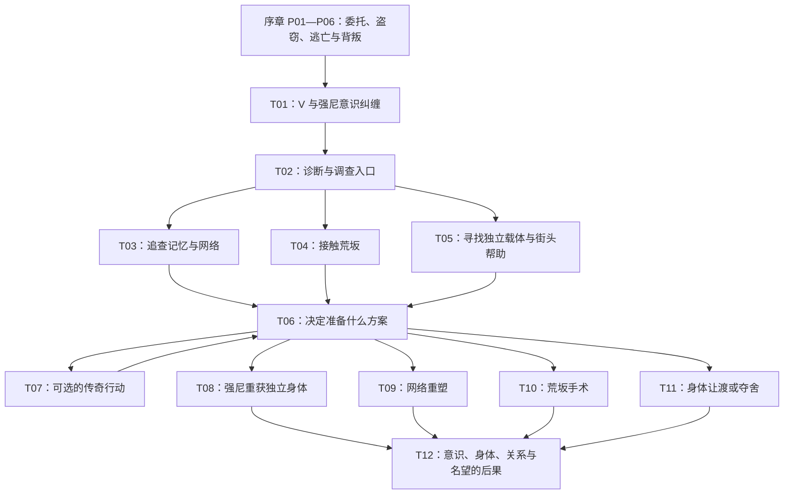

# cyberpunk 2077

本文是故事概览，维护背景、人物冲突、原作资料与开放结局方向，包含作者可见的剧透。具体场景正文、场内多轮对话与 action、结束 turn 的理由及后继衔接，统一见[场景故事稿](cyberpunk-2077-scene-story.md)；下文节点用于说明故事方向，不作为另一份场景执行定义。两份文档均不是最终模板或已可运行的剧本。

创作依据：[回合、场景与分支流转](../turn-flow.md)、[剧本结构](../scenario-schema.md)、[运行机制](../runtime.md)。本文只维护题材内容；通用机制仍由上述文档定义。当前程序尚未实现 scene 多轮互动、节点分支及运行侧自由对话。

## 1. 故事的固定起点与开放未来

2077 年，夜之城。V 接下盗取荒坂 Relic 芯片的任务，以为这是跻身顶级佣兵行列的机会。任务将 V 推入荒坂家族的权力斗争；逃亡与背叛之后，V 活了下来，却发现自己的脑中住着一个死去半个世纪的男人——强尼·银手。

**V 与强尼的意识纠缠，是本剧本不可改变的起点。** 前面的盗窃任务是可互动的序章：玩家能够改变关系、情报、留下的证据和善后方式，这些结果进入后续故事；序章最终都汇入两种意识共用一具身体的局面。

开放主线从这里开始。V 最初想摆脱强尼；强尼最初想摆脱这具陌生身体。他们不得不借助彼此活下去，也逐渐意识到：寻找分离的方法，同时意味着决定另一个人有没有资格继续存在。

夜之城给他们的答案都带着条件：荒坂能提供手术，却要取得控制权；网络能容纳意识，却未必保留一个完整的人；新的肉身意味着重新开始，却需要有人承担试验和追杀的风险。V 也可以把有限的生命投入一件足以让整座城市记住自己的事。

这里有两个分别发展的悬念：**V 与强尼最后各自成为谁；夜之城最后如何记住 V。** 成为传奇可以与意识分离、强尼在网络中生存等结果叠加，不是与其他方向互斥的单一选项。

## 2. 原作故事依据与改编边界

原作的前段路径是：德克斯雇佣 V、杰克与 T-Bug；艾芙琳提供目标情报，朱迪协助分析超梦；团队准备潜入工具并进入绀碧大厦，目标是荒坂赖宣持有的 Relic。[《The Information》任务资料](https://cyberpunk.fandom.com/wiki/The_Information)、[《The Pickup》任务流程](https://www.powerpyx.com/cyberpunk-2077-the-pickup-walkthrough/)

潜入过程中，V 与杰克目睹赖宣杀死荒坂三郎，酒店封锁。撤离时杰克重伤，最终死亡；Relic 转入 V 的神经接口。德克斯为了脱身向 V 开枪并弃尸。[《The Heist》任务资料](https://cyberpunk.fandom.com/wiki/The_Heist)、[杰克人物资料](https://cyberpunk.fandom.com/wiki/Jackie_Welles)、[V 人物资料](https://cyberpunk.fandom.com/wiki/V_%28character%29)

V 获救后，维克托解释：Relic 修复了致命伤，同时开始让强尼的印迹覆盖 V。故事由“一票成名”转向求生和身份问题。[《Playing for Time》任务资料](https://cyberpunk.fandom.com/wiki/Playing_for_Time)

后续创作借用人格印迹、Soulkiller、神舆与奥特等世界设定。数字化一个人，并不自动解决人格连续性与身体损伤。原作的荒坂路线也没有把“取出芯片”等同于完全治愈。[Soulkiller 设定资料](https://cyberpunk.fandom.com/wiki/Soulkiller)、[奥特人物资料](https://cyberpunk.fandom.com/wiki/Alt_Cunningham)、[原作结局流程](https://www.pushsquare.com/guides/cyberpunk-2077-all-endings-and-how-to-unlock-them)

本稿保留原作序章的主要转折。固定起点之后采用开放改编，不限定玩家重演原作任务和结局。**为强尼制造独立身体、建立独立网络人格居所，以及争取新的治疗条件，属于本剧本的创作方向，不宣称是原作已经提供的解决方案。**

## 3. 核心人物与冲突

| 人物 | 在故事中想得到什么 | 与玩家形成的冲突 |
| --- | --- | --- |
| V | 保住自己的意识与身体，决定怎样活、怎样被记住 | 生存、自由、同伴与名望未必能同时得到 |
| 强尼 | 重新获得行动能力，面对荒坂和自己的过去 | 他憎恶被控制，也可能把 V 当成实现目标的工具；关系可发展为敌对、合作或互相托付 |
| 维克托 | 尽量保住 V，确认每次治疗的实际代价 | 他可以诊断、质疑和稳定病情，但不会凭一句承诺突然拥有万能疗法 |
| 朱迪 | 保护朋友，不让人格技术继续吞噬人 | 她能够帮助识别被加工的记忆，要求 V 面对“复制一个人是否等于救回他” |
| 罗格 | 处理强尼留下的旧账，控制行动代价 | 她认识过去的强尼，却不会自动承认眼前的声音就是原来的那个人 |
| 竹村／荒坂谈判方 | 得到证据、技术资产与可用的盟友 | 对 V 的帮助有政治条件；竹村个人的承诺与公司的利益可能冲突 |
| 赫尔曼 | 保住自己，掌握原型技术的解释权 | 能揭示芯片用途与限制，却可能隐瞒关键材料或继续依附公司 |
| 奥特／网络接引方 | 获得进入神舆等设施的机会，处理被囚禁的人格 | 能提供数字侧帮助，但她所理解的“保存”未必是 V 所理解的“活着” |
| 夜之城的中间人与街头伙伴 | 利润、地盘、声望或互相照应 | 会根据 V 做过的事提供支持、索取报酬或拒绝同行 |

不是所有角色从开局就能联系。人物随调查与实际行动进入故事；他们只知道自己经历过或被明确告知的事。强尼不能在序章提前向 V 提供答案。

## 4. turn 的写法

下面的 ID 标识剧情节点，顺序号不代表每局实际完成的回合数。一个节点可以包含多轮谈话、调查和行动；玩家结束当前阶段后，故事根据已经发生的事实转向后继节点。

“玩家介入”列出行动方向与人物冲突，不是封闭的对白菜单。玩家可以提出自己的办法；办法必须面对当前情境的限制，结果要延续到后面。纯交谈不自动导致手术成功、获得不存在的证据或让别人同意牺牲。

此阶段只确定叙事上的进入理由、关键抉择与后果。具体数值、完整条件、结算规则、最终节点结构与模板在后续细化。

## 5. 序章：那一票生意

序章在游玩前明确标为“命运已定的往事”。它的吸引力是决定 V 带着怎样的关系、秘密与遗憾进入开放主线。也可将序章写成回忆，直接从意识纠缠开始，再逐段揭露之前发生的事。

### P01：大人物的委托

**故事。** 德克斯的车穿过夜之城。车窗外是拥挤的街道，车内是“一票之后成为大人物”的承诺。杰克相信机会来了，V 已经加入这次行动。

**玩家介入。** 追问报酬和情报来源；提出撤离、救援与分工安排；与杰克谈究竟为什么要冒险。V 可以表现为谨慎的职业佣兵，也可以把这一票当作出人头地的赌注。

**留下的分支。** 德克斯对 V 的戒心、杰克对 V 的理解，以及团队有没有额外的接应约定。后续人物会记住 V 当时说过的话，尤其是对同伴的承诺。

**后继。** P02。主要委托与参与者不变。

### P02：被剪过的记忆

**故事。** 在丽姿酒吧，艾芙琳带来赖宣套房的超梦。朱迪帮助 V 进入记录：温控箱、安保、房间细节，以及画面里没有解释清楚的东西。

**玩家介入。** 反复核对记录，询问艾芙琳隐瞒了什么；接受、拒绝或暂不回应她绕过德克斯的提议；向朱迪说明担忧，争取保留一份可用的调查线索。

**留下的分支。** V 更信任谁、谁知道 V 有疑问、是否留下可以重新追查的线索。保留线索不能在序章揭开所有幕后关系；它将在开放主线里换来新的调查入口。

**后继。** P03。

### P03：最后一杯

**故事。** 准备潜入工具的过程以短叙事衔接；来生酒吧的最后一次碰头把计划、野心与不安摆在同一张桌上。杰克谈起传奇留下的酒名。

**玩家介入。** 复核装备与接应；询问 T-Bug 对断线和暴露的判断；选择把钱用于装备还是留下救急；与杰克立下怎样的约定。

**留下的分支。** 后续能够找到的设备、紧急联系人、T-Bug 留下的工作痕迹，以及 V 对“传奇”的最初理解。准备充分可以减轻损失和保住线索。

**后继。** P04。

### P04：玻璃后的谋杀

**故事。** V 与杰克进入绀碧大厦，取到 Relic，却被迫隐藏。赖宣与三郎的争执失控，谋杀发生，酒店随即封锁。房间里的权力斗争把两个佣兵变成了必须消失的目击者。

**玩家介入。** 观察或尝试保存所见；选择优先处理哪条撤离线索；决定是否在风险中保留任务材料；对杰克说实话，或压住恐惧继续执行计划。

**留下的分支。** V 对谋杀掌握多少、证据是否可用、是否留下身份痕迹。这些影响竹村和荒坂后来为何找上 V，以及 V 在谈判时能够拿出什么。

**后继。** P05。谋杀、封锁与被迫逃亡是固定转折；本节点不承诺改变三郎的命运。

### P05：杰克留下的东西

**故事。** 逃出酒店不是胜利。Relic 的容器受损，杰克先把芯片插入自己的接口保存。车里，他的伤越来越重；最后，芯片交到 V 手中，被插入 V 的接口。车里没有庆祝，只有越来越短的谈话。

**玩家介入。** 完成与杰克最后的交流；处理他的遗物与身后安排；兑现此前约定，保住一份线索，或把仅剩的注意力放在离开追踪上。

**留下的分支。** 杰克家人和朋友后来怎样看待 V；哪些遗物、留言和承诺会再次出现。这一段不把杰克死亡当作玩家未发现隐藏选项的惩罚。

**后继。** P06。首稿采用杰克死亡、Relic 留在 V 身上的主线。

### P06：以为自己已经死了

**故事。** 德克斯背叛 V。枪响、垃圾场、断续的救援和一个不属于自己的记忆交错出现。V 的死亡经验不是故事终点；某种东西正把 V 拉回来。

**玩家介入。** 本节点主要用于过渡正文和确认继续，整理玩家此前留下的可见后果，不设置“选对一句话就避开背叛”的假分支。

**后继。** T01。所有序章路线汇入固定起点；关系、证据与善后结果继续保留。

## 6. 开放主线：两个人，一具身体

### T01：房间里只有一个人

**开篇正文。**

> V 醒来时，窗外的广告还在播放。夜之城没有因为谁死过一次而停下来。
>
> 一个陌生男人坐在房间里。他抬起金属手臂，看着 V，像是在看一场发生在自己身上的事故。
>
> V 转开视线，镜子里却只有自己。等再看过去，男人已经站到了面前。
>
> “这身体到底是谁的？”

**玩家介入。** 质问、试探、拒绝交流、尝试建立边界；向维克托求证自己的感知；面对序章留下的联系人与失去的人。强尼同样困惑，不立即成为帮助玩家解释设定的导师。

**关键抉择。** V 暂时怎样与强尼相处：合作、监视、压制，或者维持最低限度的沟通。此处决定关系的开端，不锁定结局。

**后继。** T02。后续谈话承接这里的态度；互相敌视也能推进调查。

### T02：诊断不是判决

**故事。** 维克托确认 Relic 正在改变 V，直接拔出它有致命风险。不同联系人给出互相冲突的建议：找技术人员、追查艾芙琳、利用目击证据接触荒坂，或先把日子过下去。

**玩家介入。** 追问哪些是已确认事实、哪些只是猜测；安排后续检查；决定向朋友透露多少；寻找第二个意见。V 可以不信任何人，但仍须决定下一步调查什么。

**关键抉择。** 选择先走 T03、T04 或 T05；也可以在取得新信息后回来讨论病情与方案。重复就诊必须有新情况，不把同一段诊断无限重复。

**延续的后果。** 病情是必须处理的压力，不能按每条聊天自动恶化；高风险行动、放弃治疗和明确的时间跨度，才在后续细则中承担代价。暂缓不会自动把玩家送进唯一结局。

### T03：记忆里的另一个版本

**故事。** 朱迪和强尼的旧识分别提供帮助。超梦、旧记录和强尼的回忆并不完全吻合。V 开始怀疑：眼前的强尼是那个完整的人，还是一份会自我解释、也会遗漏事实的人格印迹？

**玩家介入。** 核实强尼的说法；让他面对旧人和旧事；保留未经改写的材料；询问数字人格需要怎样的环境才能独立存在。序章保住的线索可以改变接触方式和别人愿意提供多少帮助。

**开放分支。** 强尼承认自己不知道全部真相，双方建立有限信任；V 用缺口控制强尼，关系恶化；双方暂时搁置争论，共同追查网络侧方案。

**后继。** T06；也可以带着新线索转去 T04 或 T05。这个节点打开独立网络生命的方向，不直接完成重塑。

### T04：荒坂开出的价码

**故事。** 竹村或其他有明确利益的荒坂联系人找上 V。公司需要目击者、原型数据或政治筹码，V 需要技术。个人的诚意无法代替公司合同。

**玩家介入。** 交换部分情报、提出手术与释放条件、要求独立监督、调查接收团队的身份；隐瞒强尼的情况或说明自己的底线。序章证据影响 V 有没有谈判空间。

**开放分支。** 初步达成合作；借谈判寻找技术资料；拒绝报价并带走新的调查方向。拒绝公司仍能继续故事；口头承诺也不能直接当成治疗成功。

**后继。** T06，或继续调查 T03／T05。签署不可撤销的协议放在实施节点，初次见面不锁死全部路线。

### T05：活下来的代价由谁来付

**故事。** 街头伙伴、技术人员或中间人找到另一条线索：人格可以被承载，但新的载体、隔离环境和技术并不会凭空出现。机会涉及实验设施、欠款或一笔危险的生意。

**玩家介入。** 调查技术是否可信；筹措设备和帮助；拒绝把陌生人当作可替换的容器；商量风险由谁承担。强尼可能把“再来一次”当成机会，也可能拒绝以另一个人的人生为代价。

**开放分支。** 寻找独立的人工载体，尝试让强尼重新进入现实；先建设可控制的网络居所；认为这条路代价过高，转向公司或自身生存。技术可行性仍须经过验证。

**后继。** T06，或补充调查 T03／T04。复活方向从这里成为具体工程与伦理难题。

### T06：谁有权决定我们

**故事。** V 已拿到足以比较方案的信息，强尼也有自己的选择。现在的争执不再只是互相讨厌，而是身体、记忆、自由和生存机会如何分配。

**玩家介入。** 讨论独立身体、网络存在、公司移除或身体控制权；核实缺少的条件；谈判谁保留哪些记忆；表达保住自己、保住两人或把一切押在名望上的意愿。

**关键抉择。** 形成准备实施的方案，而非点击一句话立即选择结局：独立肉身通向 T08，网络重塑通向 T09，公司分离通向 T10，交出或争夺身体通向 T11。尚未准备好时回到具体调查节点；人物和线索不会因此重置。

**延续的后果。** 强尼的同意、V 的同意、角色信任和实际操作权限分别处理。亲近不等于同意被删除，暂时让强尼控制身体也不等于永久转让。不同方案可以在不可逆操作发生前修改。

### T07：夜之城必须记住什么

**故事。** 在实施方案前，V 收到一件足以改变自己在夜之城地位的委托。它可以是夺取关键设施、救出被公司囚禁的人，或公开足以动摇权力的证据；具体目标由已经走过的路线决定。

**玩家介入。** 选择是否接下，决定靠谁完成、愿意付出什么、成果交给谁。V 可以利用这次行动取得治疗所需条件，也可以以成名为第一目标，或者拒绝它。

**开放分支。** 成功但受制于赞助者；保住自主权却损失收益；救下同伴但没有完成公开目标；留下足以被验证的壮举。失败影响资源、人情和实施条件，允许带着后果重新评估方案。

**后继。** 回到 T06 或进入已经准备好的 T08／T09／T10／T11。它是跨路线的可选关键节点，不要求所有玩家先去当传奇，也不把出名直接等同于治好 Relic。

### T08：给强尼第二具身体

**故事。** 一具独立载体终于进入可用状态。但“能写入印迹”与“醒来的是强尼”是两回事。V 必须面对试验结果、身体的归属与强尼是否愿意离开。

**玩家介入。** 检查载体来源和试验记录；要求保留强尼的记忆与自主权；在发现人格被加工或无法稳定承载时暂停；让强尼自己决定是否接受新身体。

**开放结果。** 强尼独立苏醒；得到一个记忆有缺口、需要重建关系的强尼；发现试验不可接受而中止，转向网络方案或重新调查。不能在失败后凭叙述宣布一切照常成功。

**不可逆处。** 真正分离和写入前明确后果。分离成功后仍需处理 V 的损伤；强尼的“复活”和 V 的“痊愈”是两个问题。

**后继。** 成功进入 T12；中止回 T06 或 T09。强尼重获身体后，不再被 V 当作随时可调用的脑内能力。

### T09：网络中的房间

**故事。** V 与强尼抵达网络侧的接引点。网络接引方能够帮助分离，但可能要求合并、取得访问权或留下副本。一个有强尼外貌和声音的程序，也未必拥有原来的自主性。

**玩家介入。** 谈判人格是否独立、记忆是否保留、谁可以修改它、能否拒绝访问；验证方案；决定保留联系还是彻底告别。不能仅靠把文件上传就宣布救活强尼。

**开放结果。** 强尼成为独立网络人格，与 V 保持联系；强尼选择加入更大的网络存在，双方无法再保证他原有的边界；V 拒绝条件，撤回并另寻办法。

**不可逆处。** 分离、合并或放弃原始人格之前，明确这是哪一种结果。“保存一份副本”不能被悄悄叙述成“原来的强尼继续活着”。

**后继。** 已完成分离进入 T12；未实施回 T06。进入网络也不自动消除 V 的后遗症。

### T10：手术室没有窗户

**故事。** 荒坂准备移除 Relic。医生谈技术，法务谈资产，负责交涉的人谈承诺。V 需要确认：公司同意保住的是身体、意识，还是一项可继续研究的样本。

**玩家介入。** 检查最后的协议与实施对象；兑现或撤回此前交易；决定是否为强尼争取独立保存，或接受将他的意识驱离、销毁；要求外部监督和术后离开权。强尼可以反对，但不能天然拥有对 V 身体的否决权。

**开放结果。** 移除成功，V 带着实际后遗症离开；V 活下来，却接受了公司控制；强尼被移走、被保留或被销毁，分别留下不同的告别与关系后果。公司未兑现条件时，故事进入受控处境，不能假装 V 已自由获救。

**不可逆处。** 接受公司最终条件和进入手术必须由玩家明确决定。这里允许本剧本探索新的生还条件，但必须在此前调查和交换中铺垫，不突然承诺无代价的完全治愈。

**后继。** 手术结果确定后进入 T12；术前退出回 T06。公司控制可成为后续章节的起点。

### T11：镜子另一边的名字

**故事。** 长期合作或持续压制终于让身体控制问题无法回避。强尼可能请求接管，也可能在一个此前已显露危险的失控事件中占据主导。V 面对的不是好感度奖赏，而是自己是否还能决定自己的人生。

**玩家介入。** 主动交出身体并约定 V 的去处；撤销临时授权；要求分离；寻求外部干预；在失控时争回控制。强尼的行为须承接过去的关系和行为，不能为制造反转突然变成另一个人。

**开放结果。** 双方明确同意，且此前已验证 V 的数字侧去处可行，强尼获得身体、V 转入网络；强尼在违背 V 意愿的情况下夺舍，V 的意识可能被压制或覆盖；V 成功夺回主导，但带着新的损伤返回寻找分离方法。未验证去处时，不能把让出身体写成 V 已经安全转移。

**不可逆处。** 自愿让渡与强制夺舍是两种不同结局，分别记录 V 和强尼的意愿。不能把“曾经让他办一件事”解释成永久授权。

**后继。** 控制权已经确定则进入 T12；争回身体且尚未解决 Relic 则回 T06。夺舍路线要在之前的接管经历、冲突与病情中明确预示风险。

### T12：是谁走进来生

**故事。** 医疗结果、意识去向与身体主导权已经有了答案。最后一段不只公布一个结局名字，而是让玩家看见这个答案落在生活中的样子：谁接电话，谁会来见 V，镜子里的人怎样介绍自己。

**玩家介入。** 告别或保持联系；处理未兑现的承诺；面对朋友与公司的后续要求；决定走进来生、离开夜之城，还是开启下一件事。

**结局组合。**

仍从 V 的经历呈现结果。V 被覆盖或无法感知外界时，以已知事实和尾声交代后果，不默认把玩家身份切换成强尼，也不让失去意识的 V 继续自由行动。

| 意识方向 | 这一段需要回答 | 可叠加的夜之城结果 |
| --- | --- | --- |
| 强尼独立拥有身体 | 他与 V 会继续同行还是分开；重建后的他如何证明自己 | V 成为传奇、保持匿名、失去部分关系 |
| 强尼成为独立网络人格 | 他是否还能自由联系 V；维持存在依赖什么 | V 成为传奇、隐退，或被某个网络／公司势力追踪 |
| 强尼合并或人格失去独立边界 | 留下的是怎样的存在；V 如何面对这个选择 | 被记住的壮举与私人失落可以同时成立 |
| V 与荒坂合作移除 Relic | V 是否自由，强尼被保存还是被驱除，身体还有哪些后果 | 自主传奇、公司的明星资产，或离开公众视野 |
| 强尼获得 V 的身体 | V 是否自愿、意识去了哪里；朋友是否认可眼前的人 | 城市可能记住“V”，但玩家知道如今行动的是强尼 |
| Relic 问题暂未彻底解决 | V 与强尼怎样继续相处，下一条线索是什么 | 已成为传奇、仍在挣扎，或开启下一章节 |

“成为夜之城的传奇”需要此前的行动、可见成果与城市反应来支持。它不能靠最后一句自我宣告，也不能掩盖 V 是否仍然存在。故事允许成功、妥协、失败和未解决的后续，不要求所有未来都回到原作结局。

## 7. 主线连接概览

这是故事连接示意，不是可执行节点契约。调查节点之间可以在有新理由时交叉，实施前可以改方案；不可逆操作完成后，后续承接实际结果。

## 8. 首稿的故事检查路径

以下用于审阅故事是否连贯，不是已经通过的运行验收。

1. **谨慎的 V。** 序章追问并保留证据 → 与强尼互相监视 → 和荒坂谈判 → 争取明确的手术与离开条件 → 取出 Relic；面对被驱离的强尼和自己留下的后遗症。
2. **试图救两个人的 V。** 向朱迪求证记忆 → 与强尼和解但保持边界 → 寻找独立载体 → 拒绝牺牲第三人的方案 → 通过危险行动取得条件 → 强尼重获身体，V 继续处理自身损伤。
3. **相信网络的 V。** 调查人格印迹 → 验证独立人格居所 → 与接引方谈判 → 保住强尼的自主性并完成分离 → 日后可以联系，但关系不再是共用身体。
4. **把控制当成合作的 V。** 多次临时交出身体 → 对边界争议置之不理 → 强尼开始越权 → 失控节点争夺主导；自愿让渡、成功争回与强制夺舍有不同后果。
5. **想成为传奇的 V。** 在任一调查路线中争取街头支持 → 接下并完成可见的重大行动 → 继续选择意识方案 → 结尾同时呈现城市名望和私人的代价。
6. **中途改变想法的 V。** 与荒坂初步合作 → 发现最终条件不可接受 → 术前退出 → 带着已经付出的代价改走网络路线。改路保留旧关系与损失，不重开一个没有过去的 V。

## 9. 后续细化边界

故事下一步应先展开 T01—T06 的节点正文、人物回应和跨节点后果，确认玩家确实能走出不同关系与调查路径；再细化独立肉身、网络、公司与控制权四个方向，以及传奇行动的具体内容。

未在本稿确定的内容包括人工载体的具体来源、网络接引条件、荒坂交易对象与价格、重大委托的任务细节、病情和手术的精确判定。它们应在故事细化中形成一致的因果关系，再转入规则和模板制作。

本稿不创建最终模板，不编造已导入、已试玩或已完成技术验收的记录。
